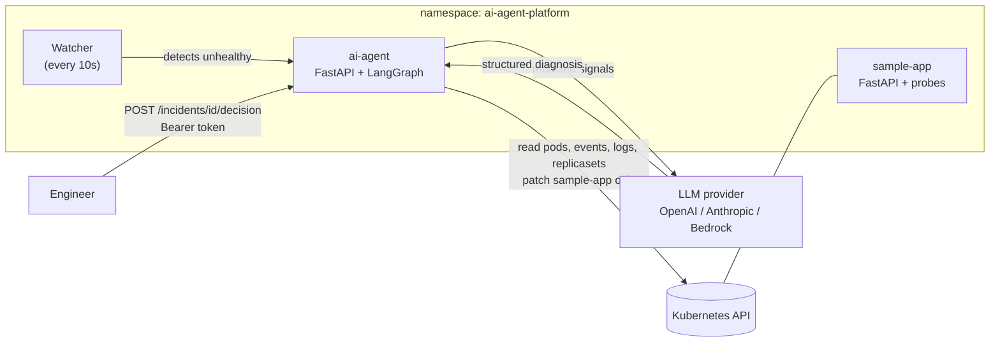

# AI Agent Platform

AI-powered Kubernetes troubleshooting and auto-remediation agent built with **LangGraph**, **LangChain** and **Kubernetes**.

The agent watches an application, collects signals (pod status, events, logs, deployment revision history), diagnoses the incident with an LLM, proposes an **allowlisted** fix (restart, scale up or rollback), waits for **human approval**, executes it, **verifies** recovery and writes an **audit log**.

| Documentation | Where |
|---|---|
| Run **locally** (tests, local Kubernetes with Helm) | **This file** |
| Run on **AWS EKS** | `docs/DEPLOY-EKS.md` here, and the full runbook in **aws-infra/README.md** |

---

## Contents

1. [Architecture](#1-architecture)
2. [Safety controls](#2-safety-controls)
3. [Decision rules and tested scenarios](#3-decision-rules-and-tested-scenarios)
4. [Prerequisites](#4-prerequisites)
5. [One-time setup](#5-one-time-setup)
6. [Run the tests](#6-run-the-tests)
7. [Run locally on Kubernetes (kind + Helm)](#7-run-locally-on-kubernetes-kind--helm)
8. [Try it - step by step](#8-try-it---step-by-step)
9. [Agent API](#9-agent-api)
10. [Deploy to AWS EKS](#10-deploy-to-aws-eks)
11. [Troubleshooting](#11-troubleshooting)
12. [Clean up](#12-clean-up)
13. [Reference](#13-reference)

---

## 1. Architecture




The agent and the sample app run in the **same namespace** (`ai-agent-platform`). The agent may change **only** the `sample-app` deployment (RBAC `resourceNames`), so it can never restart, scale or roll back itself.

---

## 2. Safety controls

| Control | How |
|---|---|
| Allowlisted actions | Only `restart_deployment`, `scale_up` and `rollback` can run; everything else is refused |
| Human approval | The graph pauses with a LangGraph `interrupt` until an engineer approves or rejects |
| Approval expiry | Pending approvals expire after 10 minutes so they never block the watcher |
| API authentication | All incident endpoints require `Authorization: Bearer <AGENT_API_TOKEN>` |
| Secret redaction | API keys, tokens, passwords, JWTs and private keys are removed from logs, events and env before reaching the LLM |
| Least-privilege RBAC | Read pods/logs/events/replicasets; change only `deployments/sample-app` - no delete, no secrets |
| Dry-run mode | `AGENT_DRY_RUN=true` approves without touching the cluster |
| Verification | After acting, the agent waits until all replicas are ready |
| Audit log | Every decision (approved, rejected, expired, not required) is written to `audit/audit.jsonl` |
| Cooldowns | 120 s after an action, 30 s after a "none" decision |
| Probe timing | Liveness restarts after ~90 s (10 s × 9) so the watcher (~40 s) sees the failure first |
| Secrets | API keys live in a Kubernetes Secret (from `.env` locally, from GitHub secrets on EKS) |

---

## 3. Decision rules and tested scenarios

The LLM applies ordered rules to the unhealthy pod; the first match wins and the rule number is recorded in the reason.

| # | Condition | Action |
|---|---|---|
| 1 | All containers ready | `none` |
| 2 | OOMKilled or memory growth | `investigate` |
| 3 | Crash / startup failure **and** a new revision exists | `rollback` |
| 4 | Crash / startup failure, no recent revision | `investigate` |
| 5 | Fresh container, no restarts, no errors | `none` (still starting) |
| 6 | Running but probes failing | `restart_deployment` |
| 7 | Evidence of overload | `scale_up` |
| 8 | Anything else | `investigate` |

Verified both on local kind and on AWS EKS:

| Scenario | Trigger | Agent decision |
|---|---|---|
| App unhealthy (HTTP 503) | `POST /simulate-failure` | Watcher → `restart_deployment` (rule 6) → approve → verified healthy |
| Memory leak (OOMKilled) | `POST /simulate-memory-leak` | `investigate` (rule 2) |
| Bad release (CrashLoopBackOff) | `CRASH_ON_STARTUP=true` on the deployment | Watcher → `rollback` (rule 3) → approve → previous revision restored |
| Healthy | - | `none` (rule 1) |

---

## 4. Prerequisites

All commands are for **Git Bash on Windows**.

| Tool | Needed for | Check |
|---|---|---|
| Python 3.13 | Tests and development | `python --version` |
| Docker Desktop with Kubernetes (**kind**, 1 node) | Local Kubernetes | `kubectl get nodes` |
| Helm 3+ | Local Kubernetes | `helm version` |
| OpenAI API key (or Anthropic) | The agent's LLM | - |

Docker Desktop → **Kubernetes** → **Create cluster** → **kind**, 1 node → **Create**, and tick **Show system containers (advanced)** (needed to load images into the node).

---

## 5. One-time setup

### 5.1 Python environment

```bash
cd "/d/AI Projects/ai-agent-platform"
python -m venv .venv
source .venv/Scripts/activate
python -m pip install -r requirements.txt
```

✅ `(.venv)` at the start of the prompt.

### 5.2 `.env`

```bash
cp .env.example .env
python -c "import secrets; print('AGENT_API_TOKEN=' + secrets.token_urlsafe(32))"
notepad .env
```

Set (no quotes, no spaces around `=`):

| Line | Value |
|---|---|
| `OPENAI_API_KEY=` | your OpenAI key |
| `ANTHROPIC_API_KEY=` | your Anthropic key (optional) |
| `AGENT_API_TOKEN=` | the token printed above (exactly **one** line) |
| `LLM_PROVIDER=` | `openai` |

```bash
grep -c '^AGENT_API_TOKEN=' .env       # must print 1
```

---

## 6. Run the tests

No cluster and no API keys needed:

```bash
python -m pytest -q
```

✅ All tests pass.

---

## 7. Run locally on Kubernetes (kind + Helm)

### 7.1 Use the local cluster

```bash
kubectl config use-context docker-desktop
kubectl get nodes
```

✅ `desktop-control-plane   Ready`

### 7.2 Remove the old raw-manifest install (only if you used `k8s/` before)

```bash
kubectl delete namespace ai-agent sample-app --ignore-not-found
```

### 7.3 Build the images and load them into the node

```bash
docker build -t sample-app:1.1 sample-app
docker build -t ai-agent:1.6 agent
docker save sample-app:1.1 | docker exec -i desktop-control-plane ctr -n k8s.io images import -
docker save ai-agent:1.6 | docker exec -i desktop-control-plane ctr -n k8s.io images import -
docker exec desktop-control-plane crictl images | grep -E "sample-app|ai-agent"
```

✅ Both images listed. (Tags must match `helm/ai-agent-platform/values.yaml`.)

### 7.4 Namespace and secret

```bash
kubectl create namespace ai-agent-platform
kubectl create secret generic ai-agent-secrets -n ai-agent-platform --from-env-file=.env
```

### 7.5 Install with Helm

```bash
helm lint helm/ai-agent-platform -f helm/ai-agent-platform/values-local.yaml
helm upgrade --install ai-agent-platform helm/ai-agent-platform -n ai-agent-platform \
  -f helm/ai-agent-platform/values-local.yaml
kubectl get pods -n ai-agent-platform -w
```

✅ `ai-agent` and `sample-app` `1/1 Running` → press **Ctrl+C**.

### 7.6 Open the services

Window 1:

```bash
kubectl port-forward -n ai-agent-platform svc/sample-app 8081:80
```

Window 2:

```bash
kubectl port-forward -n ai-agent-platform svc/ai-agent 8090:80
```

> Every restart or rollback replaces the `sample-app` pod and **breaks window 1's port-forward** - press Ctrl+C there and run it again before the next test.

---

## 8. Try it - step by step

The same steps work on local kind and on EKS. In **window 3**:

```bash
cd "/d/AI Projects/ai-agent-platform"
TOKEN=$(grep -m1 '^AGENT_API_TOKEN=' .env | cut -d= -f2-)
AUTH="Authorization: Bearer $TOKEN"
approve_latest() {
  ID=$(curl -s -H "$AUTH" http://127.0.0.1:8090/incidents | python -c "import sys,json; d=json.load(sys.stdin); p=[i for i in d if i.get('status')=='pending_approval']; print(p[-1]['id'] if p else '')")
  if [ -z "$ID" ]; then echo "No pending incident"; return; fi
  echo "Approving incident $ID"
  curl -s -X POST -H "$AUTH" -H "Content-Type: application/json" \
    -d '{"approve": true}' http://127.0.0.1:8090/incidents/$ID/decision | python -m json.tool
}
curl -s http://127.0.0.1:8081/status; echo
curl -s http://127.0.0.1:8090/health; echo
curl -s -o /dev/null -w "No token: %{http_code}\n" http://127.0.0.1:8090/incidents
```

✅ `{"application":"sample-app","healthy":true,"environment":"kubernetes"}` · `{"status":"healthy"}` · `No token: 401`.

### 8.1 Unhealthy app → restart (watcher)

```bash
curl -s -X POST http://127.0.0.1:8081/simulate-failure; echo
sleep 50
curl -s -H "$AUTH" http://127.0.0.1:8090/incidents | python -m json.tool
```

✅ An incident with `"source": "watcher"`, `"status": "pending_approval"`, `"action": "restart_deployment"`. (If not yet, wait 20 s - the 120 s cooldown after a previous action may still be running.)

```bash
approve_latest
kubectl get pods -n ai-agent-platform
```

✅ `"executed": true`, `"healthy": true` and a new `sample-app` pod. Restart window 1.

Reject instead (repeat the trigger first):

```bash
ID=$(curl -s -H "$AUTH" http://127.0.0.1:8090/incidents | python -c "import sys,json; d=json.load(sys.stdin); p=[i for i in d if i.get('status')=='pending_approval']; print(p[-1]['id'] if p else '')")
curl -s -X POST -H "$AUTH" -H "Content-Type: application/json" \
  -d '{"approve": false}' http://127.0.0.1:8090/incidents/$ID/decision | python -m json.tool
curl -s -X POST http://127.0.0.1:8081/simulate-recovery; echo
```

✅ `"approval": "rejected"`, nothing changed; the app recovers.

### 8.2 Manual diagnosis (no watcher)

```bash
curl -s -X POST http://127.0.0.1:8081/simulate-failure; echo
sleep 5
curl -s -X POST -H "$AUTH" http://127.0.0.1:8090/incidents | python -m json.tool
approve_latest
```

✅ `"source": "manual"`, `restart_deployment`, then executed and verified. Restart window 1.

### 8.3 Memory leak → investigate

```bash
curl -s -m 5 -X POST http://127.0.0.1:8081/simulate-memory-leak; echo
kubectl get pods -n ai-agent-platform -w
```

When `sample-app` shows `RESTARTS 1`, press Ctrl+C:

```bash
kubectl get pod -n ai-agent-platform -l app=sample-app -o jsonpath='{.items[0].status.containerStatuses[0].lastState.terminated.reason}'; echo
curl -s -X POST -H "$AUTH" http://127.0.0.1:8090/incidents | python -m json.tool
```

✅ `OOMKilled`, then `"recommended_action": "investigate"`, reason `2` - no approval requested.

### 8.4 Bad release → rollback

```bash
kubectl set env deployment/sample-app -n ai-agent-platform CRASH_ON_STARTUP=true
sleep 60
kubectl get pods -n ai-agent-platform
curl -s -H "$AUTH" http://127.0.0.1:8090/incidents | python -m json.tool
approve_latest
kubectl rollout status deployment/sample-app -n ai-agent-platform
kubectl get deployment sample-app -n ai-agent-platform -o jsonpath='{.spec.template.spec.containers[0].env}'; echo
```

✅ New pod `CrashLoopBackOff`, incident `"action": "rollback"` (rule 3); after approval `from_revision N` → `to_revision N-1` and only `ENVIRONMENT` in the env list.

> `kubectl set env` changes the Helm-managed deployment directly; the next `helm upgrade` (or CD deploy) resets it.

### 8.5 Least privilege and audit log

```bash
SA=$(kubectl get deploy ai-agent -n ai-agent-platform -o jsonpath='{.spec.template.spec.serviceAccountName}')
kubectl auth can-i patch deployment/sample-app -n ai-agent-platform --as=system:serviceaccount:ai-agent-platform:$SA
kubectl auth can-i patch deployment/ai-agent   -n ai-agent-platform --as=system:serviceaccount:ai-agent-platform:$SA
kubectl auth can-i get secrets                  -n ai-agent-platform --as=system:serviceaccount:ai-agent-platform:$SA
kubectl auth can-i delete pods                  -n ai-agent-platform --as=system:serviceaccount:ai-agent-platform:$SA
MSYS_NO_PATHCONV=1 kubectl exec -n ai-agent-platform deploy/ai-agent -- tail -n 5 /app/audit/audit.jsonl
```

✅ `yes`, `no`, `no`, `no`, and one audit line per decision.

---

## 9. Agent API

All endpoints except `/health` require `Authorization: Bearer <AGENT_API_TOKEN>`.

| Method | Endpoint | Purpose |
|---|---|---|
| GET | `/health` | Health check |
| POST | `/incidents` | Start a diagnosis manually |
| GET | `/incidents` | List incidents |
| GET | `/incidents/{id}` | Incident details (including approval expiry) |
| POST | `/incidents/{id}/decision` | `{"approve": true}` or `{"approve": false}` |
| POST | `/alerts` | Prometheus Alertmanager webhook |

---

## 10. Deploy to AWS EKS

Same Helm chart, deployed by GitHub Actions into namespace `ai-agent-platform` on the shared cluster from **aws-infra**. Everything runs from the GitHub web UI.

| Step | Where | Click |
|---|---|---|
| 1 | aws-infra | **Actions** → **Bootstrap** → **Run workflow** → action `apply` |
| 2 | aws-infra | **Actions** → **Terraform** → **Run workflow** → action `apply` (about 20 min) |
| 3 | this repo (once) | **Settings** → **Secrets and variables** → **Actions** → variables and secrets from `docs/DEPLOY-EKS.md` |
| 4 | this repo | **Actions** → **CD** → **Run workflow** → action `deploy` |
| 5 | laptop | `aws eks update-kubeconfig --name karthik-eks --region ap-south-1`, then section 7.6 port-forwards and section 8 |
| Remove | this repo | **Actions** → **CD** → **Run workflow** → action `uninstall` |
| Remove all | aws-infra | **Terraform** `destroy` (confirm `destroy`), then **Bootstrap** `destroy` (confirm `destroy`) |

> The cluster costs about **$0.20/hour** while it exists.

Details: `docs/DEPLOY-EKS.md` and **aws-infra/README.md**.

---

## 11. Troubleshooting

| Problem | Fix |
|---|---|
| `ErrImageNeverPull` | Repeat 7.3; image tags must match `values.yaml` |
| `docker exec desktop-control-plane` fails | Docker Desktop → Kubernetes → **Show system containers** |
| Agent pod `CreateContainerConfigError` | Secret missing: 7.4 |
| `401` from the agent | Wrong token: `grep -c '^AGENT_API_TOKEN=' .env` must be 1; on EKS the GitHub secret must match `.env` |
| No watcher incident, pod restarted by itself | Liveness probe was faster than the watcher - the chart uses 9 × 10 s; `helm upgrade` / CD deploy the latest chart |
| No watcher incident after 50 s | 120 s cooldown after the previous action - wait and check again; `kubectl logs -n ai-agent-platform deploy/ai-agent --tail=20` |
| Empty response from `:8081` | Stale port-forward after a pod replacement - restart window 1 |
| `bash: syntax error near unexpected token newline` | `<id>` pasted literally - use `approve_latest` |
| `tail: cannot open 'C:/Program Files/Git/app/...'` | Git Bash path conversion - prefix with `MSYS_NO_PATHCONV=1` |
| `-l app.kubernetes.io/name=sample-app` returns nothing | The pod label is `app=sample-app` |
| `Error: rendered manifests contain a resource that already exists` | Old raw-manifest objects - 7.2 |

---

## 12. Clean up

```bash
helm uninstall ai-agent-platform -n ai-agent-platform
kubectl delete namespace ai-agent-platform
```

---

## 13. Reference

### Repository structure

```
ai-agent-platform/
├── sample-app/                 # Demo FastAPI app with failure simulations + Dockerfile
├── agent/                      # AI agent + Dockerfile
│   ├── llm/                    # Provider factory: openai | anthropic | bedrock
│   ├── tools.py                # Read-only Kubernetes signal tools (redacted)
│   ├── redact.py               # Secret redaction
│   ├── actions.py              # Allowlisted actions: restart, scale_up, rollback
│   ├── diagnose.py             # Read-only diagnosis graph
│   ├── remediate.py            # Diagnose -> approve -> execute -> verify graph
│   └── server.py               # HTTP API (token auth) + watcher
├── helm/ai-agent-platform/     # Helm chart (values.yaml, values-local.yaml, values-eks.yaml)
├── k8s/                        # Original raw manifests (learning reference; Helm replaces them)
├── docs/DEPLOY-EKS.md          # EKS deployment for this repo
├── tests/                      # pytest (no LLM or cluster needed)
└── .github/workflows/          # ci.yml (automatic), cd.yml (manual deploy / uninstall)
```

### Watcher and probe settings (`values.yaml`)

| Setting | Value | Meaning |
|---|---|---|
| `WATCH_INTERVAL_SECONDS` | 10 | How often the watcher scans |
| `UNHEALTHY_THRESHOLD_SECONDS` | 30 | Unhealthy this long → incident |
| `INCIDENT_COOLDOWN_SECONDS` | 120 | Quiet period after an action |
| `NONE_COOLDOWN_SECONDS` | 30 | Quiet period after a "none" decision |
| `APPROVAL_TIMEOUT_SECONDS` | 600 | Pending approval expires |
| `sampleApp.probes.liveness` | 10 s × 9 | Kubelet restart after ~90 s (later than the watcher) |
| `sampleApp.probes.readiness` | 5 s × 2 | Removed from the Service after ~10 s |

### LLM providers

| Provider | Model setting | Auth |
|---|---|---|
| `openai` | `OPENAI_MODEL_ID` (default `gpt-4o-mini`) | `OPENAI_API_KEY` |
| `anthropic` | `ANTHROPIC_MODEL_ID` (default `claude-haiku-4-5`) | `ANTHROPIC_API_KEY` |
| `bedrock` | `BEDROCK_MODEL_ID` | AWS credentials / IAM role |

A typical diagnosis uses about 1,500-1,700 tokens.
