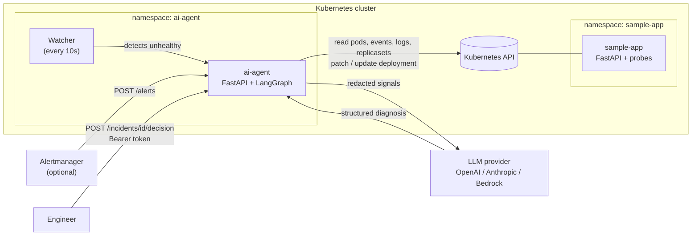
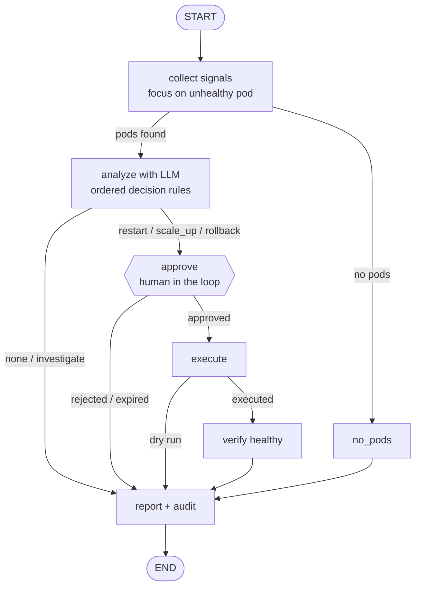

# AI Agent Platform

AI-powered Kubernetes troubleshooting and auto-remediation agent built with **LangGraph**, **LangChain** and **Kubernetes**.

The agent watches an application, collects signals (pod status, events, logs, deployment revision history), diagnoses the incident with an LLM, proposes an **allowlisted** fix (restart, scale up or rollback), waits for **human approval**, executes it, **verifies** recovery and writes an **audit log**.

## Architecture



## Agent workflow (LangGraph)



## Safety controls

| Control | How |
|---|---|
| Allowlisted actions | Only `restart_deployment`, `scale_up` and `rollback` can run; everything else is refused |
| Human approval | Graph pauses with a LangGraph `interrupt` until an engineer approves or rejects |
| Approval expiry | Pending approvals expire after 10 minutes so they never block the watcher |
| API authentication | All incident endpoints require `Authorization: Bearer <AGENT_API_TOKEN>` |
| Secret redaction | API keys, tokens, passwords, JWTs and private keys are removed from logs, events and env before reaching the LLM |
| Least-privilege RBAC | ServiceAccount can read pods/logs/events/replicasets and patch/update deployments in `sample-app` only - no delete, no secrets, no other namespaces |
| Dry-run mode | `AGENT_DRY_RUN=true` approves without touching the cluster |
| Verification | After acting, the agent waits until all replicas are ready |
| Audit log | Every decision (approved, rejected, expired) is written to `audit/audit.jsonl` |
| Cooldowns | 120s after an action, 30s after a "none" decision, to avoid remediation loops |
| Secrets | API keys stored in a Kubernetes Secret created from `.env`, never in Git |

## Decision rules

The LLM applies ordered rules to the unhealthy pod; the first match wins and the rule number is recorded in the reason.

| # | Condition | Action |
|---|---|---|
| 1 | All containers ready | `none` |
| 2 | OOMKilled or memory growth | `investigate` |
| 3 | Crash / startup failure **and** a new revision exists | `rollback` |
| 4 | Crash / startup failure, no recent revision | `investigate` |
| 5 | Fresh container, no restarts, no errors | `none` (still starting) |
| 6 | Running but probes failing | `restart_deployment` |
| 7 | Evidence of overload | `scale_up` |
| 8 | Anything else | `investigate` |

## Tested failure scenarios

| Scenario | Trigger | Agent decision |
|---|---|---|
| App unhealthy (HTTP 503) | `POST /simulate-failure` | `restart_deployment` → approve → verified healthy |
| Memory leak (OOMKilled) | `POST /simulate-memory-leak` | `investigate` - restart would only hide the leak |
| Bad release (CrashLoopBackOff) | `kubectl set env ... CRASH_ON_STARTUP=true` | `rollback` → approve → previous revision restored, verified healthy |
| Healthy | - | `none` |

## Repository structure

```
ai-agent-platform/
├── sample-app/            # Demo FastAPI app with failure simulations
│   ├── app.py
│   ├── Dockerfile
│   └── requirements.txt
├── agent/                 # AI agent
│   ├── llm/               # Provider factory: openai | anthropic | bedrock
│   ├── tools.py           # Read-only Kubernetes signal tools (redacted)
│   ├── redact.py          # Secret redaction
│   ├── actions.py         # Allowlisted actions: restart, scale_up, rollback
│   ├── diagnose.py        # Read-only diagnosis graph
│   ├── remediate.py       # Diagnose -> approve -> execute -> verify graph
│   ├── server.py          # HTTP API (token auth) + watcher
│   ├── Dockerfile
│   └── requirements.txt
├── k8s/
│   ├── sample-app/        # namespace, deployment, service
│   └── ai-agent/          # namespace, serviceaccount, role, rolebinding, configmap, deployment, service
├── iam/                   # Least-privilege Bedrock IAM policy
├── tests/                 # pytest with fakes (no LLM or cluster needed)
└── .github/workflows/     # CI: tests + image builds + smoke tests
```

## LLM providers

Switch provider and model with `.env` or command-line arguments - no code changes.

| Provider | Default model | Auth |
|---|---|---|
| `openai` | `gpt-5.6-luna` | `OPENAI_API_KEY` |
| `anthropic` | `claude-haiku-4-5` | `ANTHROPIC_API_KEY` |
| `bedrock` | `us.anthropic.claude-haiku-4-5-20251001-v1:0` | AWS credentials / IAM role |

A typical diagnosis uses about 1,000-1,500 tokens.

## Quick start (local, Docker Desktop + kind)

```bash
# 1. Python environment
python -m venv .venv
source .venv/Scripts/activate        # Windows Git Bash
pip install -r requirements.txt
cp .env.example .env                 # add API keys and AGENT_API_TOKEN

# 2. Tests
python -m pytest -v

# 3. Build images and load them into the kind node
docker build -t sample-app:1.1 sample-app
docker build -t ai-agent:1.6 agent
docker save sample-app:1.1 | docker exec -i desktop-control-plane ctr -n k8s.io images import -
docker save ai-agent:1.6   | docker exec -i desktop-control-plane ctr -n k8s.io images import -

# 4. Deploy
kubectl apply -f k8s/sample-app/namespace.yaml
kubectl apply -f k8s/sample-app/
kubectl apply -f k8s/ai-agent/namespace.yaml
kubectl create secret generic ai-agent-llm -n ai-agent --from-env-file=.env
kubectl apply -f k8s/ai-agent/

# 5. Access
kubectl port-forward -n sample-app svc/sample-app 8081:80
kubectl port-forward -n ai-agent svc/ai-agent 8090:80
```

## Demo

```bash
export AGENT_API_TOKEN=$(grep '^AGENT_API_TOKEN=' .env | cut -d= -f2-)
AUTH="Authorization: Bearer $AGENT_API_TOKEN"

# Scenario A: app unhealthy -> restart
curl -X POST http://127.0.0.1:8081/simulate-failure

# Scenario B: bad release -> rollback
kubectl set env deployment/sample-app -n sample-app CRASH_ON_STARTUP=true

# The watcher creates an incident automatically after 30s; list it
curl -s -H "$AUTH" http://127.0.0.1:8090/incidents

# Approve the proposed action
curl -s -X POST -H "$AUTH" -H "Content-Type: application/json" \
  -d '{"approve": true}' http://127.0.0.1:8090/incidents/<id>/decision
```

## Agent API

All endpoints except `/health` require `Authorization: Bearer <AGENT_API_TOKEN>`.

| Method | Endpoint | Purpose |
|---|---|---|
| GET | `/health` | Health check (no auth) |
| POST | `/incidents` | Start a diagnosis manually |
| GET | `/incidents` | List incidents |
| GET | `/incidents/{id}` | Incident details, including approval expiry |
| POST | `/incidents/{id}/decision` | Approve or reject (`{"approve": true}`) |
| POST | `/alerts` | Prometheus Alertmanager webhook |

## Roadmap

- [x] Rollback action using deployment revision history
- [x] Approval expiry and API token authentication
- [x] Secret redaction before LLM calls
- [ ] Persistent incident store (Postgres checkpointer) to allow multiple replicas
- [ ] Persistent audit log (PVC or log shipping)
- [ ] Slack approval buttons instead of curl
- [ ] Prometheus metrics as an additional signal
- [ ] Deploy to EKS with Terraform and IRSA / Pod Identity for Bedrock
